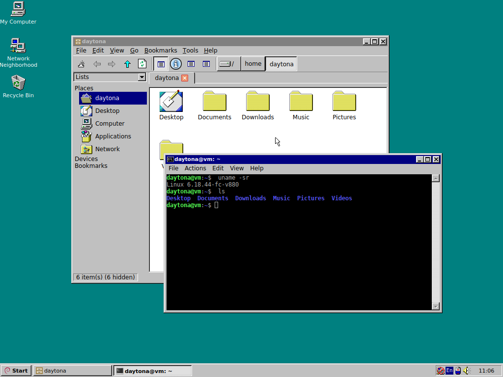
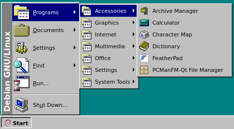
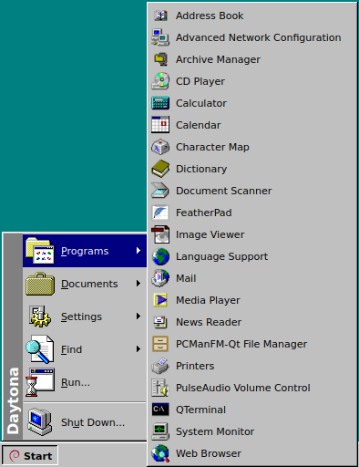
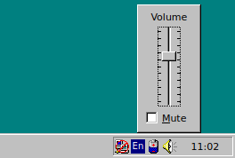
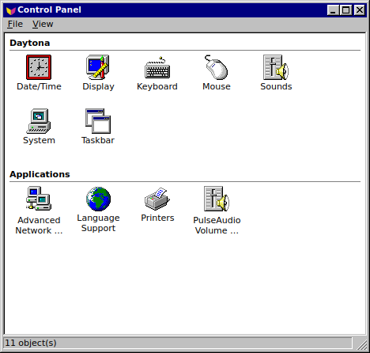
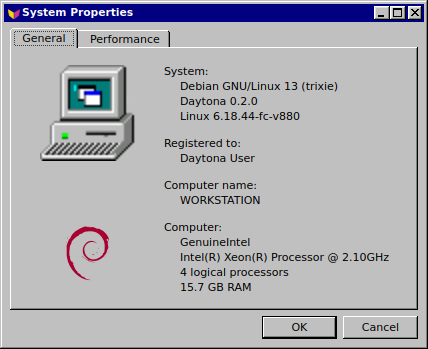
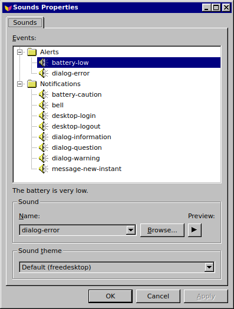
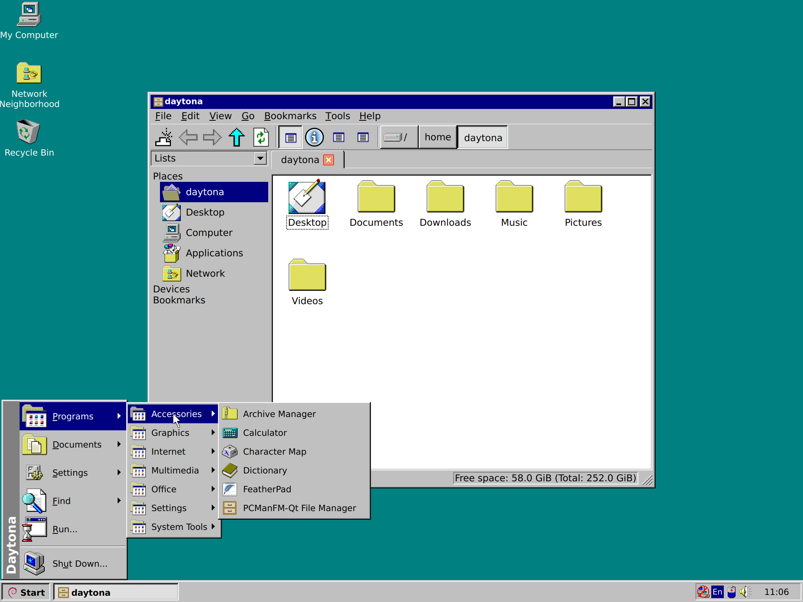
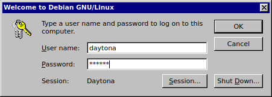

# Daytona Desktop Environment


Inspired by Windows NT, [Chicago95](https://github.com/grassmunk/Chicago95) and built with Qt6 Widgets, a functional Qt desktop environment with the familiarity of the NT and 9X era.

> [!WARNING]
> **Early development.** Daytona currently targets **Debian 13** and may contain incomplete features, bugs or breaking changes. See [AGENT.md](AGENT.md) for the project's design principles and development rules.

> [!IMPORTANT]
> **THIS PROJECT IS VIBE-CODED.** Development is primarily performed by AI agents working from GitHub issues and defined project rules. Code may not have undergone comprehensive human review. Users should exercise appropriate caution, particularly when installing on their primary systems.

## A tour of Daytona

The screenshots below were taken from a build of `main`, running in Daytona's own patched labwc.

### The desktop



The taskbar, Start menu, desktop icons (My Computer, Network Neighborhood, Recycle Bin) and
notification area are all part of the Daytona shell. labwc draws NT's raised window frames, with
Daytona's patch for them. Folders open in [PCManFM-Qt](https://github.com/lxqt/pcmanfm-qt), and
any Qt application takes on the `daytona` style.

### Start menu

| Program groups (default) | Flat list |
| :---: | :---: |
|  |  |

**Programs** is built from the freedesktop menu specification, so every installed application
shows up in its program group. Put `FlatPrograms=true` in the `[StartMenu]` section of
`~/.config/daytona/daytona.ini` for one flat list of programs, as in early NT. Start's banner
shows your distribution's logo when it has one.

### Notification area



The tray holds the clock and Daytona's own volume (with NT's pop-up), battery and input
locale icons, beside any application's StatusNotifierItem icon, such as NetworkManager's network
icon. Old XEmbed tray icons (GtkStatusIcon, Wine) are shown there too.

### Control Panel



Daytona's own applets (Date/Time, Display, Keyboard, Mouse, Sounds, System and Taskbar) sit
above every installed application in the freedesktop **Settings** category.

### System Properties



Open it from Control Panel, **Properties** on My Computer or Win+Pause. The General tab shows the
distribution (with its logo), the Daytona version, kernel, processor and memory; the Performance
tab shows memory and swap use.

### Sounds



Event sounds for log on, log off, message boxes and balloons come from the freedesktop sound
theme. Each event's sound and the theme can be changed here; the volume and mixer are in
PulseAudio Volume Control.

### HiDPI



Everything is drawn in logical pixels at the screen's scale, here 200% (2048 × 1536). Set it per
screen in Display Properties > Settings > Font Size; see [docs/hidpi.md](docs/hidpi.md).

### Log on screen (optional)



`daytona-greeter` is an optional Windows 98-style log on screen for greetd, with a session
chooser and Shut Down; see [Optional: the Daytona log on screen](#optional-the-daytona-log-on-screen).

## Installing on Debian 13

Daytona has an apt repository for Debian 13 (amd64 and arm64) at
<https://jzu.me/daytona/>, with two suites:

- `stable`: tagged releases.
- `edge`: the latest build of `main`, for testing. Only the newest builds are kept.

Add the signing key (fingerprint `3AED 05B9 6FFE F7E8 7C6B 7249 6099 9388 8173 8EAD`):

```bash
sudo curl -fsSLo /etc/apt/keyrings/daytona.gpg https://jzu.me/daytona/daytona-archive-keyring.gpg
```

Add the repository, with `Suites: stable` or `Suites: edge`:

```bash
sudo tee /etc/apt/sources.list.d/daytona.sources <<'END'
Types: deb
URIs: https://jzu.me/daytona
Suites: edge
Components: main
Signed-By: /etc/apt/keyrings/daytona.gpg
END
```

Then install:

```bash
sudo apt update && sudo apt install daytona
```

Updates then come with `sudo apt update && sudo apt upgrade`. To report a crash, also install
`daytona-dbgsym` (debug symbols for the shell and Daytona's labwc) so backtraces show function
names. Log out and back in after an update
of Daytona; your settings (colour scheme, wallpaper, taskbar) are kept.

The packages can also be installed by hand: download them from a GitHub release, or from the
**Packages (amd64)** or **Packages (arm64)** artifact of a CI run, or build them yourself (below),
then install both:

```bash
sudo apt install ./daytona_*.deb ./daytona-chicago95_*.deb
```

The packages:

- `daytona` holds the shell, the `daytona` Qt style, `daytona-themetool`, the labwc configuration
  and the session file, and its own build of labwc with Daytona's window frame patch, installed
  privately in `/usr/libexec/daytona` so a system labwc is left alone. It pulls in the Qt
  runtime it needs. It recommends WirePlumber, for the volume keys, pavucontrol-qt, the
  mixer that the speaker icon opens and the Control Panel lists, sound-theme-freedesktop and
  libcanberra-pulse, for event sounds (log on, log off, message boxes, balloons), UPower, for the battery icon,
  and brightnessctl, for the brightness keys (members of the `video` group can change the
  backlight; Debian's installer adds the first user to it), and grim and wl-clipboard, for Print
  Screen.
- `daytona-chicago95` holds the Chicago95 GTK theme, icons and cursors, built from the pinned
  submodule.
- `daytona-greeter` (optional, not installed with `daytona`) holds the log on screen for greetd;
  see below.

Then log out and choose **Daytona** in your login manager's session menu. It is installed as
a Wayland session in `/usr/share/wayland-sessions/daytona.desktop`. GDM, SDDM and LightDM all list
it there.

### Optional: the Daytona log on screen

`daytona-greeter` is a Windows 98-style log on screen to match: user name, password, a
**Session...** button to pick the desktop (Daytona or any other installed Wayland session) and
**Shut Down...**. It is a separate, optional package built on the
[greetd](https://sr.ht/~kennylevinsen/greetd/) login manager; Daytona works with any login
manager and never installs it for you.

To replace your current login manager (GDM, SDDM, LightDM, ...) with it:

```bash
sudo apt install daytona-greeter
sudo cp /usr/share/doc/daytona-greeter/examples/config.toml /etc/greetd/config.toml
systemctl status display-manager      # note which one is running now
sudo systemctl disable gdm3           # or sddm, lightdm: the one shown above
sudo systemctl enable --force greetd
sudo reboot
```

The copied `config.toml` runs `daytona-greeter` as greetd's greeter on virtual terminal 7; if you
already have a greetd configuration, change only its `[default_session]` command to
`"daytona-greeter"`. On a high-density screen, use `"daytona-greeter --scale 2"` (any size
from 1 to 3, such as 1.5). To go back, `sudo systemctl disable greetd`, enable your old login manager
again with `sudo systemctl enable --force gdm3` (or `sddm`, `lightdm`) and reboot. See
[docs/greeter.md](docs/greeter.md) for how it works, troubleshooting and limits.

To build the packages:

```bash
sudo apt install dpkg-dev debhelper fakeroot && sudo apt build-dep .
```

```bash
dpkg-buildpackage -us -uc -b
```

The packages are written to the parent directory. To give them a snapshot version as CI does
(below), run `scripts/snapshot-version.sh` first; it adds an entry to `debian/changelog`.

### Versions and updates

Builds of `main` have a snapshot version made from the commit they were built from, such as
`0.1.0+git20261125222910.412d7ba`: the release version, the commit's date and time (UTC) and its
short hash. Each build is newer than the last, and newer than the release before it, so apt
upgrades to it. Packages installed by hand are upgraded the same way, by installing newer ones over
them. `dpkg -l daytona` shows which version is installed.

Packages built before snapshot versions all have version `0.1.0`. To replace one of those with
another `0.1.0` build, add `--reinstall`.

### Releasing

1. Run `scripts/release.sh 0.2.0 "Summary of the release"` to add the version to
   `debian/changelog`, then commit it and merge it to `main`.
2. Tag that commit and push the tag: `git tag v0.2.0 <commit> && git push origin v0.2.0`.

CI builds the packages for the tag (it checks that the tag matches `debian/changelog`). The apt
workflow (`.github/workflows/apt.yml`) then publishes them as the `v0.2.0` GitHub release and in
the `stable` suite. Builds of `main` keep going to the rolling `edge` prerelease and the `edge`
suite, which keep only the two newest builds. Every deployment rebuilds the whole site, so removed
builds leave it, and the repository is signed with the key in the `GPG_SIGN_PRIVATE` secret
(public key: `packaging/apt/daytona-archive-keyring.asc`).

## Building

Daytona uses git submodules for [Chicago95](https://github.com/grassmunk/Chicago95) and [labwc](https://github.com/labwc/labwc). Clone with:

```bash
git clone --recurse-submodules https://github.com/JZUME/daytona.git
```

or, in an existing clone:

```bash
git submodule update --init
```

Daytona targets Debian 13 (trixie). Install the build dependencies:

```bash
sudo apt install build-essential cmake ninja-build pkgconf qt6-base-dev qt6-base-private-dev \
    liblayershellqtinterface-dev libwayland-dev libwayland-bin wayland-protocols \
    qt6-wayland-dev qt6-wayland-dev-tools qt6-wayland-private-dev qt6-svg-plugins \
    libpulse-dev libcanberra-dev libpam0g-dev libxcb1-dev libxcb-composite0-dev \
    libxcb-damage0-dev python3 clang-format
```

`sudo apt build-dep .` installs the same list from `debian/control`.

The build also compiles labwc from its submodule with Daytona's patch for NT's raised window
frames (`patches/labwc/`), which needs labwc's own build dependencies:

```bash
sudo apt install meson libwlroots-0.18-dev wayland-protocols libxkbcommon-dev libxcb1-dev \
    libxcb-icccm4-dev libdrm-dev libxml2-dev libglib2.0-dev libcairo2-dev libpango1.0-dev \
    libinput-dev libpixman-1-dev libpng-dev librsvg2-dev libsfdo-dev
```

Configure with `-DDAYTONA_BUILD_LABWC=OFF` to skip it and use the system's labwc instead; window
frames are then flat.

Configure, build and run the tests:

```bash
cmake -S . -B build -G Ninja
cmake --build build
ctest --test-dir build
```

Pass `-DDAYTONA_WERROR=ON` to treat compiler warnings as errors, as CI does.

### Smoke tests

Smoke tests run a real headless labwc session against an install of the build and check screenshots. They are enabled when these are installed:

```bash
sudo apt install labwc grim wlr-randr qt6-wayland qt6-svg-plugins dbus
```

The pointer tests also need `wlrctl`, the autostart test `dex` and `gdbus` (`libglib2.0-bin`), the screen saver test `wlrctl` and `swayidle`, the Print Screen test `wl-clipboard`, and the XEmbed tray tests `xwayland`.

Run only the smoke tests with:

```bash
ctest --test-dir build -L smoke --output-on-failure
```

To add one, write a script in `tests/smoke/` that starts what it needs and checks the screen with `wait_for_pixels` from `lib.sh` (it retries until the pixels match or the time runs out), then register it in `tests/smoke/CMakeLists.txt`:

```cmake
daytona_add_smoke_test(smoke_my_feature smoke_my_feature.sh)
```

The script runs inside the session with `WAYLAND_DISPLAY` set, and the build's `bin/` and test helpers on `PATH`. Check a few specific pixels (a colour at a known position) rather than comparing whole images.

Format code before committing:

```bash
clang-format -i $(git ls-files '*.cpp' '*.h')
```

## Developing in Codespaces

The repository has a dev container (`.devcontainer/`, Debian 13) that works in GitHub Codespaces or any dev container tool. It needs no GPU or display: labwc runs headless with software rendering, and the desktop is shown in your browser through noVNC.

1. Create a Codespace on the `main` branch (Code → Codespaces). Submodules are fetched automatically.
2. Run the VS Code task **Daytona: Run desktop** (Terminal → Run Task…). It configures, builds and
   installs Daytona into `build/prefix`, then starts the desktop. Wait for "Daytona development
   session is running" in its terminal.
3. Open the forwarded port **6080** from the Ports tab and choose `vnc.html` → Connect.
4. In a second terminal, run applications inside the session:

   ```bash
   source /tmp/daytona-dev-$(id -u)/session.env
   qterminal &
   ```

5. Take a screenshot with the **Daytona: Screenshot** task (or `scripts/screenshot.sh [file.png]`).
   Stop the session with **Daytona: Stop desktop** or Ctrl+C in its terminal.

**Daytona: Widget Gallery** opens Qt's Widget Gallery (`qt6-base-examples`) in the running desktop:
most standard widgets in one window, with a check box to disable them all, for checking the Daytona
style. `scripts/widget-gallery.sh widgets/dialogs/standarddialogs` (or `widgets/mainwindows/menus`)
opens another Qt example instead.

Other tasks: **Daytona: Build** (the default build task, Ctrl+Shift+B), **Daytona: Run tests**, and
**Daytona: Run desktop (2×)** and **(1.5×)**, which start the desktop at HiDPI scales (see
[docs/hidpi.md](docs/hidpi.md)). At those scales the noVNC canvas is larger than the logical
desktop: keep noVNC's Scaling Mode on None to check pixels, or use Local Scaling for an overview.
Without VS Code, run the same steps by hand: configure and build as above, then
`cmake --install build --prefix build/prefix` and `scripts/dev-session.sh`. The session uses
`build/prefix` when it exists, so the Daytona and Chicago95 themes, icons and cursors are
available, and starts its own D-Bus session bus if there is none.

Set `DAYTONA_OUTPUT_SIZE` (default `1024x768`) to change the virtual screen size. The VNC server and noVNC listen on localhost only; Codespaces forwards port 6080 privately to you.

The same scripts work outside a container on any Debian 13 machine with the packages from `.devcontainer/Dockerfile` installed.

## Licence

GPL-3.0-or-later. See [LICENSE](LICENSE).

## Trademarks

Daytona is an independent project. It is not affiliated with, endorsed by or
sponsored by Microsoft Corporation. Microsoft, Windows and Windows NT are
trademarks of the Microsoft group of companies, used here only to describe
the style Daytona follows. Daytona ships no Microsoft artwork, fonts, sounds
or logos; its icons come from [Chicago95](https://github.com/grassmunk/Chicago95)
(see [third_party/README.md](third_party/README.md)).
